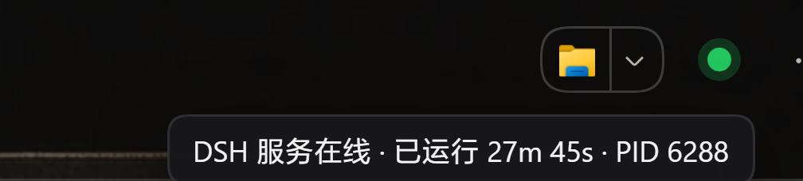
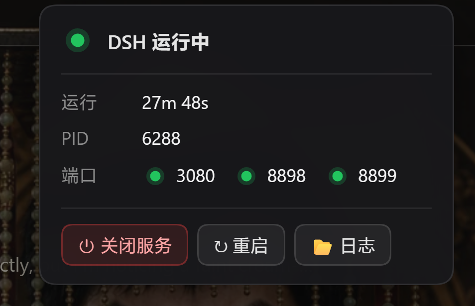

# dsh-status-dot

[DeepSeek Harness](https://github.com/deepseek-ai/dsh) 会话头部的状态圆点：一眼看出本地 DSH 服务是否存活；鼠标悬停显示运行时长 / PID；点开是一个只读小面板（运行时长 / PID / 端口状态）。

本仓库提供**两个各自独立的包**，**只装其中一个**：

| 包 | 做什么 | 控制动作 |
|---|---|---|
| [`dsh-status-dot`](./dsh-status-dot) | 圆点 + 悬停气泡 + 只读面板 | **完全没有** —— 代码里根本不存在控制通道 |
| [`dsh-status-dot-control`](./dsh-status-dot-control) | 同样的圆点与面板，另有 启动 / 关闭 / 重启 / 日志 | **装完即用**：先走同源 HTTP 动作路由，默认交给随包自带脚本执行（想接自己的脚本用 `controlVbs` 覆盖），走不通才回退到 `meowdsh://` 协议处理程序 |

两个包注册**相同的 HTTP 路由**，所以不建议同时安装 —— 二选一。

## 长什么样

在会话头部（右起第三个位置）：


鼠标悬停 —— 气泡显示运行时长与 PID：



点一下 —— 展开面板（控制版另有三颗动作按钮）：



> 三张都是在真实运行中的 DSH 界面上直接截的（3 倍放大），没有任何后期绘制。

---

## 安装

两个版本都以「可直接安装的 tarball」挂在 **Release 资源**上，一条命令即可（**不需要 git**）：

```bash
# 只读版
dsh plugin --profile web add https://github.com/StarflowDream/dsh-status-dot/releases/download/v1.0.0/dsh-status-dot-1.0.0.tgz

# 控制版（与上面二选一）
dsh plugin --profile web add https://github.com/StarflowDream/dsh-status-dot/releases/download/v1.0.3/dsh-status-dot-control-1.0.3.tgz
```

⚠️ **不要用仓库 tarball**（`.../tar.gz/<sha>`）：本仓库两个包在子目录里，压缩包根目录没有 `package.json`，pnpm 会直接失败。请用上面的 `dist/` 包。

从本地目录安装：

```bash
dsh plugin --profile web add file:/path/to/dsh-status-dot/dsh-status-dot
```

装完**必须重启 DSH**（`dsh web` 或桌面端应用）—— 插件 bundle 只在启动时并入 profile 层栈。圆点出现在每个会话的头部（欢迎页没有会话头部，先打开一条会话）。

## 配置

在 `$DSH_HOME/profiles/<profile>/cordis.patch.yml` 里按 profile 配置：

```yaml
- id: dsh-status-dot          # 装控制版就写 dsh-status-dot-control
  config:
    enabled: true
    ports: [3080]             # 要探测的端口，默认 [3080]
```

**支持哪些入口（不用改配置）**：主端口不是写死的，而是从请求的 `Host` 头推出来 —— 所以 `dsh web`（默认 3080）和 **DSH 桌面端**（默认 19387）都能直接用，换端口、两个入口同时开着也不影响。要顺带盯的**额外**服务（例如手机登录入口 8898）用 `extraPorts` 列：

```yaml
    extraPorts: [8898, 8899]                          # 或 [{ port: 8898, label: phone-login }]
```

## 控制版：装完即用，动作交给谁可以换

控制版**自己不启停任何东西** —— 它只负责把动作交出去。交出去有两条路，优先第一条。

**① 同源 HTTP 动作路由（默认路径）**

服务端半边注册 `POST /dsh-status-dot/action?action=<start|stop|restart|logs>`。这条路由和状态端点走**同一套 DSH 浏览器围栏**（没有有效 DSH cookie 一律 401），并且它**不自己动手**：命中后隔 1 秒，用独立进程执行处理器脚本 ——

```
wscript.exe <controlVbs> meowdsh://<动作> [appPath] [processName]
```

- 1 秒延迟刻意留在服务端进程里，好让 HTTP 响应先回到页面再动手。
- 经 `wscript` 而不是直接 `spawn`：实测在 Windows 上 `spawn` 起 powershell 加 `detached:true` 会**静默退出、exit 0、什么都不跑**，不加 detached 又会随本进程一起死。
- 动作白名单是 `start` / `stop` / `restart` / `logs`，其它值不会被转交。
- **默认处理器＝随包自带的脚本**（`scripts/dsh-control.vbs` → `scripts/dsh-control.ps1`）。路径由插件用 `import.meta.url` 就地算出，包里不含任何作者机器上的路径，所以**装上就能用**：不用写脚本，也不用注册协议。它做的事：
  - `stop`：把该 app 的**全部同名进程一次性强杀**。这个 app 的主进程、`--type=` 辅助进程和 host 子进程镜像名相同，而只有 host 子进程监听端口；只杀监听者会留下一个活着但"宿主已死"的窗口，渲染出「应用无法启动或已意外停止」。一次扫完才不会出现那个半死瞬间。
  - `restart`：**先**安排重开（同一个 vbs，默认 6 秒后），**再**停 —— 这个脚本本身可能被这一停带走，先排后停才保证能回来。
  - `start`：已在跑就跳过；否则依次找 config 的 `appPath` → 运行中进程的 exe 路径 → 常见安装目录（`%LOCALAPPDATA%\Programs`、`%ProgramFiles%` 等）下的 `DeepSeek Harness.exe`。
  - `logs`：打开日志目录。`status`：只报告发现了什么（安全，测试与探针用）。
  - 自己的日志写在 `%USERPROFILE%\.dsh\dsh-status-dot-control.log`。
- 换成你自己的处理器（例如顺便管别的服务）就覆盖 `controlVbs`：

```yaml
- id: dsh-status-dot-control
  config:
    enabled: true
    # 可选：不写＝用包里自带的那个
    controlVbs: 'D:\your\path\dsh-control.vbs'
    # 可选：只在 start 找不到 exe / 进程名不同时才需要
    appPath: 'D:\your\path\DeepSeek Harness.exe'
    processName: 'DeepSeek Harness'
```

`appPath` / `processName` 会作为额外位置参数交给处理器（不经 shell 拼串）；不认识这两个参数的自定义 handler 会直接忽略它们。

**② `meowdsh://` 协议处理器（回退路径）**

HTTP 那条走不通时（比如旧版插件、服务端半边不在），客户端退回打开 `meowdsh://<动作>`，由操作系统交给**你自己的处理器脚本**。没有注册处理器时这条路什么也不会发生。Windows 上的做法是注册一个 `HKCU\Software\Classes\meowdsh` 协议项，指向为你的环境做实际启停的脚本；若你已用别的协议名，改 `dsh-status-dot-control/lib/client.js` 里的 `PROTOCOL_BASE` 即可。

## 安全与隐私

两个版本都是刻意做小的，下面几条是**设计约束**，改动时请保持：

- **完全没有对外网络通信。** 客户端只调同源的相对路径；服务端只对 `127.0.0.1:<配置的端口>` 做 TCP 探测。没有遥测、没有统计、没有远程日志 —— **你的 API key / token 不可能经由这个插件离开本机。**
- **路由走 DSH 自己的浏览器围栏。** 直接注册在 `webServer` 上的路由默认没有鉴权，所以**每个**端点（`status` / `log` / 控制版的 `action`）都调用 `connection.requestRejection(req)`，并在该服务不可用时退回严格同源检查。**没有有效 DSH cookie 的请求一律 401**（包括控制动作）。
- **不发 CORS 头。** 客户端本来就是同源请求，所以故意不写 `Access-Control-Allow-Origin` —— 其他网站读不到这些响应。
- **响应体最小化。** 只有 `{ alive, pid, startedAt, uptimeMs, node, ports }` —— 不含文件路径、不含命令行、不含监听 URL，因此泄漏不出用户名或目录结构。
- **插件自己不写任何磁盘文件。** 控制版随包的处理器脚本另算：它只往 `%USERPROFILE%\.dsh\dsh-status-dot-control.log` 追加几行动作记录（谁在什么时候要求了什么、结果如何），便于事后核对；不传配置、不传进程命令行。
- 破坏性操作（关闭 / 重启）先弹确认框；只读版里根本没有这类代码。

## 开发笔记：这个宿主的两个坑

（都是用放大截图验证出来的，不看 computed style）

- **形状一律用 SVG 画，别用 CSS 画。** 一个加了样式的 `<span>` 圆点会被宿主样式变成方框；而 `border-radius:50%` + `box-shadow` 画的圆环**实际渲染成圆角方形**，尽管 `getComputedStyle()` 返回的是 `50%`。
- **圆点按钮上不要加 `title`。** 操作系统会额外画一个原生 tooltip，于是同时出现两个提示框；而且因为它是 OS 绘制的，**截图里根本拍不到**。

## 更新记录

### v1.0.3（2026-10-11）—— 控制版：修掉 1.0.2 的客户端回归

- **1.0.2 的客户端改动会让桌面端启动失败，这一版把它逐字节回滚了。** 1.0.2 把"候选槽位只要存在就停"改成"只有 `register` 真的成功才停，否则继续试下一个槽位"；但插件加载器的注入回调是**延后执行**的，于是"注册成功"这个判断在循环里永远为假，圆点组件被塞进**所有**候选槽位，桌面端 Web 启动期 `@deepseek-ai/dsh-client-ui-sidebar` / `@deepseek-ai/dsh-client-ui-conversation` 两个官方插件直接 `failed`（`web boot: 11 entries did not activate`），应用弹「应用无法启动或已意外停止」。现已回滚到 1.0.1 那一版客户端代码（sha256 前 16 位 `cdbf9e1b4dae6f8a`，此前连跑一整天没出过问题），并加了一条判据禁止这种写法回来。
- **装了 1.0.2 的请换 1.0.3**：1.0.2 在桌面端会导致启动失败（Web 端也可能面板不出现）。
- **1.0.2 的其余修复全部保留**（重启 6s→3s、`relaunch` 先等旧进程消失、动作必须 POST、`via` 只回文件名、主端口取套接字、Node 太老回 500、`stop` 端口探针、双引号拒绝——详见下面 v1.0.2 一节）：它们都在服务端，不参与 Web 启动，与这次回归无关。
- 只读版仍是 1.0.0，无改动。

### v1.0.2（2026-10-11）—— 控制版：重启更快，一批审计修复

- **重启更快：固定等待 6s → 3s。** 客户端点下去后本来就先等 1s 才触发动作，那 6 秒只是"让回复先到页面"的余量，砍掉 3 秒。
- **重启不再可能"停掉了却没起来"（这次最要紧的一条）。** 原来的"先排 3 秒后的启动、再停"有时间窗反转：万一强杀清理比那个延迟还慢，启动分支看到旧进程还在就判定"已在运行"直接返回，随后旧进程才死干净 —— 服务停着。现在延迟启动走新的 `relaunch` 动作：**先等旧进程真的消失**（最多 25s）再启动。
- **控制动作必须是 POST**：同源 GET（地址栏 / `` / prefetch）以前也能停服务，现在非 POST 一律 405。
- **响应不再回绝对路径**：`via` 原来会回 `wscript C:\Users\<用户名>\…`，与"响应不含任何文件系统路径"的自述冲突；现在只回文件名。
- **主端口优先取请求套接字**：反代/隧道下 `Host` 头带的是入口端口（或没端口），原来会回落到写死的 3080、把在线服务画成离线；现在按 `req.socket.localPort` → `Host` → 默认 排序，`portSource` 说明用了哪一个。
- **不再是"报了成功其实没动"**：Node < 20.16（没有 `process.getBuiltinModule`）时直接回 500 带原因并声明 `engines.node >= 20.16`；`stop` 找不到同名进程时会探一下端口（动作请求会把自己的端口传下去），端口还在听就记 FAIL。
- ~~**面板更不容易整块不出现**：客户端原来只要槽位存在就 `break`，哪怕 register 被拒；现在只有 register 真的成功才停，否则继续试下一个候选槽位。~~ **⚠️ 这条在 v1.0.3 被回滚了**：注入回调是延后执行的，"注册成功"这个判断在循环里永远看不到，结果组件被注册进所有候选槽位、桌面端起不来（见上）。
- 其它：`appPath`/`processName` 含双引号直接拒绝；围栏遇到非数字 rejection 回落到 403；两处与实现不符的文案改掉。**只读版仍是 1.0.0，无改动。**

### v1.0.1（2026-10-11）—— 控制版：开箱即用

- **装上就能用，不用注册任何东西。** 控制版以前把动作交给「你自己注册的 `meowdsh://` 处理器」——没注册时点了不会有任何反应。现在默认交给**包里自带的脚本**（`scripts/dsh-control.vbs` → `scripts/dsh-control.ps1`），路径由插件用 `import.meta.url` 就地算出，发布包里不含任何作者机器上的路径。
- **支持 DSH 桌面端。** 桌面端（Electron 壳）不把 `meowdsh://` 交给系统协议处理器，所以旧路径在桌面端**完全无效**。新版先走同源 HTTP 动作路由 `POST /dsh-status-dot/action`（照样过 DSH 自己的浏览器围栏，没有 cookie 一律 401），只有在浏览器 / 旧服务端上才回退协议。`dsh web` 与桌面端两种入口都可用。
- **「关闭服务」不再弹「应用无法启动或已意外停止」。** 桌面端主进程、`--type=` 辅助进程和真正监听端口的 host 子进程**同名**；只杀监听者会留下一个活着但"宿主已死"的窗口，渲染出恢复框。随包脚本一次扫掉整棵同名进程树，`restart` 则**先**排好重开**再**停（脚本自己可能被这一停带走）。
- **只读版没有改动**（仍是 1.0.0）：它本来就不含控制通道。
- 想接自己的处理器：用 `controlVbs` / `appPath` / `processName` 覆盖，见上一节。

完整列表见 [CHANGELOG.md](./CHANGELOG.md)。

## 许可

MIT —— 见 [LICENSE](./LICENSE)。

---

## English summary

A status dot for the DeepSeek Harness conversation header: hover for uptime/PID, click for a read-only panel (uptime / PID / port state). The three screenshots at the top are captured from a live DSH UI at 3× zoom. This repository ships **two self-contained packages** — `dsh-status-dot` (read-only; contains no control channel at all) and `dsh-status-dot-control` (adds start / stop / restart / logs: the client POSTs to the same-origin `/dsh-status-dot/action` route, which the server half hands to the handler script bundled with the package — `wscript <scripts/dsh-control.vbs> meowdsh://<action>` — so it works right after install, with no protocol handler to register and no script of your own — control package v1.0.1: the handler ships inside the tarball, and the dot works on the DSH desktop app too, because the desktop shell never hands `meowdsh://` to the OS (the old protocol-only path did nothing there); point `config.controlVbs` at your own handler to take over, and it falls back to a registered `meowdsh://` protocol handler when the HTTP route is unavailable). The bundled handler stops the app in one single sweep of all same-named processes (killing only the port listener leaves a half-dead window that renders the crash-recovery dialog), schedules the relaunch before stopping so a restart can never lose the app, and discovers the executable from the running process or the usual install folders. Install exactly one of the packages: both register the same HTTP routes. Install from the tarballs in `dist/` (a plain repository tarball will not work — the packages live in subdirectories). Restart DSH (`dsh web` or the desktop app) afterwards — the main port comes from the request `Host` header, so both entries (default 3080 / 19387) and any other port work as-is, and `config.extraPorts` watches auxiliary services. Security properties are load-bearing and documented in the Chinese section above: no outbound network traffic, every route (including the control action) passes through DSH's own browser fence (401 without a cookie), no CORS headers, minimal response body; the plugin itself writes nothing to disk (the bundled handler only appends action lines to `%USERPROFILE%\.dsh\dsh-status-dot-control.log`).
